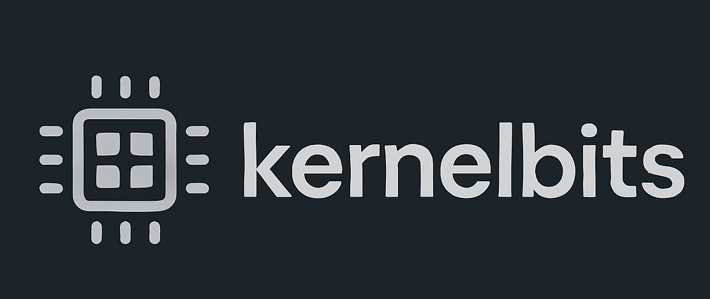

# 👋 Hi, I'm Hamed Mani

I'm a **Computer Science Student & Full-Stack Developer** who loves building production-ready applications. I specialize in the modern web ecosystem, focusing on performance, scalability, and clean architecture.

### 🚀 Featured Projects
- **[MedMode](https://medmode.tn)**: A full-stack e-commerce platform built with Next.js, Prisma, and PostgreSQL (Neon).
- **[ProConnet](https://proconnet.tn)**: A high-performance frontend for a digital agency using React and Tailwind CSS.
- **AI Recognition Pipeline**: An end-to-end OCR and validation system containerized with Docker.

### 💻 Tech Stack
     

    

## 🌐 Connect with me:
  

# 📊 GitHub Stats:
 
 

### ✍️ Dev Wisdom

---

